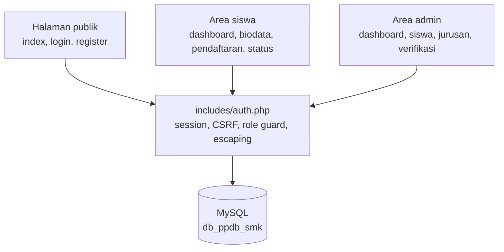
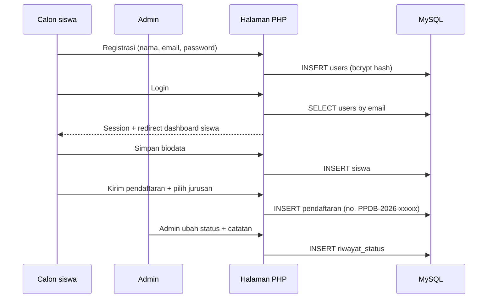
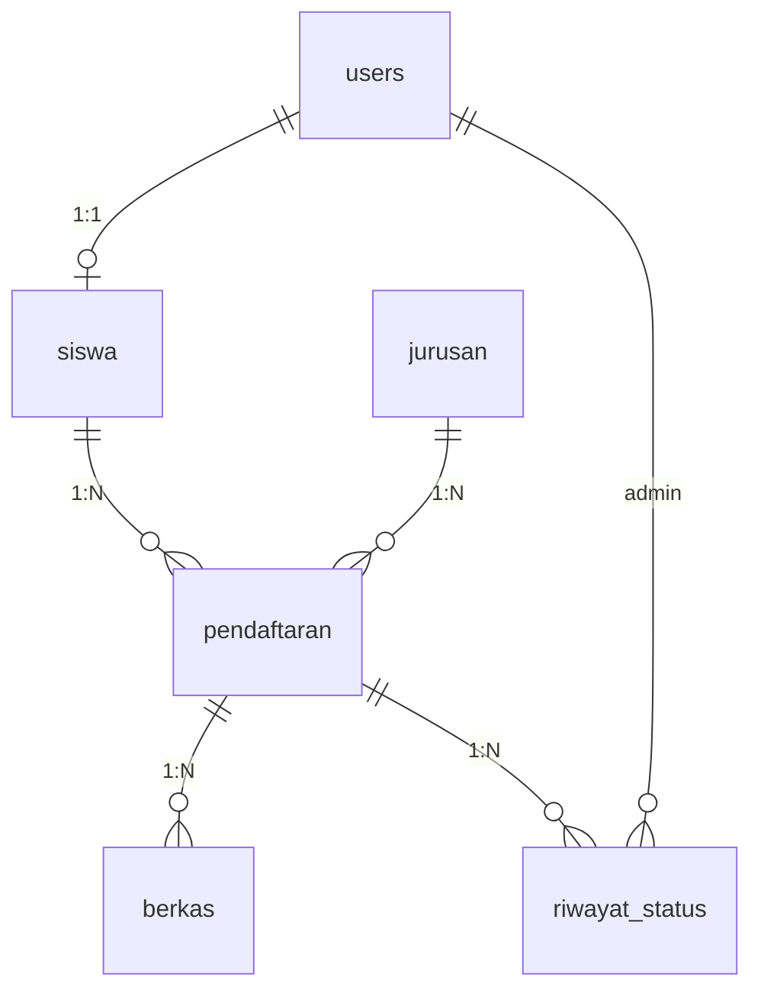

# PPDB Online SMK Nusantara

Aplikasi web penerimaan peserta didik baru untuk SMK Nusantara yang dibangun sebagai tugas mata kuliah Pemrograman Web. Repo ini berisi dua versi yaitu prototipe statis yang bisa dibuka langsung di browser dan aplikasi PHP murni tanpa framework dengan MySQL yang punya alur pendaftaran, verifikasi, dan pencatatan riwayat status.

[](ppdb-smk/)
[](ppdb-smk/db_ppdb_smk.sql)
[](ppdb-smk/includes/header.php)
[](https://github.com/irsyad-a/tugas-pemrograman-webB-2026/commits/main)

> Status: **Beta**. Perlu pengembangan lebih lanjut lagi terutama terkait keamanan SQL

---

### Isi di repo ini

Terdapat dua folder dan dua tingkat kedalaman implementasi di proyek ini:

| Folder | Isi | Kebutuhan |
|---|---|---|
| [ppdb-web/](ppdb-web/) | Prototipe tampilan halaman publik (HTML, CSS, JavaScript). Login dan Daftar masih placeholder. Ini menjadi referensi untuk dasar frontend proyek ini | Browser biasa. |
| [ppdb-smk/](ppdb-smk/) | Aplikasi PHP murni tanpa framework dengan MySQL. Autentikasi, dashboard, pengelolaan jurusan, verifikasi. | PHP, MySQL, Apache. |

Repo ini juga bagian dari kumpulan tugas Mata Kuliah Pemrograman Web B 2026 di [irsyad-a/tugas-pemrograman-webB-2026](https://github.com/irsyad-a/tugas-pemrograman-webB-2026). 

---

### Fitur

**Calon siswa**

1. Registrasi akun dengan nama, email, dan password minimal 8 karakter.
2. Login dan logout.
3. Mengisi dan memperbarui biodata.
4. Memilih jurusan dan mengirim pendaftaran, yang kemudian mendapatkan nomor pendaftaran secara otomatis.
5. Memantau status pendaftaran beserta riwayat perubahan status.

**Admin sekolah**

1. Dashboard statistik yang termasuk total pendaftar, jumlah menunggu, diterima, ditolak, plus daftar 5 pendaftar terbaru.
2. Melihat dan mencari data siswa. Pencarian bisa memfilter berdasarkan nama, NISN, atau email, dan status pendaftaran tiap siswa ikut ditampilkan.
3. Kelola jurusan yang bisa menambahkan jurusan baru yang lengkap dengan kuota dan deskripsi. Bisa juga mengaktifkan atau menonaktifkan jurusan yang sudah ada.
4. Verifikasi pendaftaran: ubah status dengan status Menunggu, Diverifikasi, Diterima, Ditolak dengan catatan dan setiap perubahan tercatat di riwayat status.

**Umum**

1. Pisahkan hak akses berdasarkan role.
2. Token CSRF pada semua form yang mengubah data yang akan dirotasi tiap kali dipakai.
3. Password disimpan dengan `password_hash()` dan bcrypt cost 12.

---

### Arsitektur

Aplikasi [ppdb-smk/](ppdb-smk/) memakai PHP prosedural, satu file per halaman, dan satu helper auth yang dipakai bersama.



Alur pendaftaran sampai verifikasi:



---

### Menggunakan proyek

Tutorial ini digunakan jika kamu sudah punya XAMPP (atau Apache + PHP + MySQL 8).

#### 1. Siapkan database

Buat file bernama `import.sql` yang isinya seluruh isi [ppdb-smk/db_ppdb_smk.sql](ppdb-smk/db_ppdb_smk.sql). Kemudian, buka tab **Import** di phpMyAdmin dan jalankan. Database `db_ppdb_smk` beserta 6 tabel dan data awal jurusan nantinya akan ikut terbentuk.

Alternatif tanpa phpMyAdmin bisa dilakukan denganm menjalankan perintah ini dari terminal XAMPP:

```bash
mysql -u root -p < ppdb-smk/db_ppdb_smk.sql
```

Di PowerShell:

```powershell
Get-Content ppdb-smk/db_ppdb_smk.sql -Raw | mysql -u root -p
```

#### 2. Taruh aplikasi di document root

Salin folder [ppdb-smk/](ppdb-smk/) ke folder `htdocs` XAMPP sehingga path akhirnya `C:\xampp\htdocs\ppdb-smk`. Path ini wajib, karena seluruh tautan internal memakai prefix `/ppdb-smk/`.

#### 3. Atur kredensial database

Buka [ppdb-smk/config/database.php](ppdb-smk/config/database.php). Host, nama database, dan user sudah bawaan XAMPP. Password diambil dari environment variable `DB_PASSWORD`; kalau variable itu tidak ada, passwordnya kosong, yang cocok dengan instalasi XAMPP standar.

Di Command Prompt:

```bash
setx DB_PASSWORD "password_mysql_kamu"
```

Di bash:

```bash
export DB_PASSWORD="password_mysql_kamu"
```

#### 4. Jalankan

Buka `http://localhost/ppdb-smk/` di browser. Halaman depan mengarahkan pengguna yang sudah login ke dashboard sesuai role-nya.

#### 5. Masuk sebagai admin

| Email | Password |
|---|---|
| admin@smknusantara.sch.id | admin123 |

Anda bisa mengganti password ini sebelum nantinya dipakai di _real project_. Akun admin dibuat dari seed di file SQL, dan hash-nya sudah diverifikasi memakai bcrypt cost 10.

---

### Struktur folder

```text
tugas-pweb-week11/
├── PRD_PPDB_Online_SMK_Nusantara.md      # Dokumen kebutuhan produk
├── README.md                             # Dokumen ini
├── ppdb-smk/                             # Aplikasi PHP + MySQL
│   ├── .htaccess                         # Matikan listing, tolak file konfigurasi
│   ├── config/database.php               # Koneksi PDO, prepared statement
│   ├── includes/
│   │   ├── auth.php                      # Session, CSRF, guard role, escaping
│   │   ├── header.php                    # Layout atas + Bootstrap CDN
│   │   └── footer.php
│   ├── auth/                             # login, register, logout
│   ├── siswa/                            # dashboard, biodata, pendaftaran, status
│   ├── admin/                            # dashboard, siswa, jurusan, verifikasi
│   ├── assets/css/main.css               # Token warna, layout, komponen
│   ├── assets/js/main.js                 # Toggle nav mobile, konfirmasi hapus
│   ├── uploads/                          # Dokumen pendaftar 
│   ├── db_ppdb_smk.sql                   # Skema + seed
│   └── index.php
└── ppdb-web/                             # Prototipe statis
    ├── index.html
    ├── styles.css
    └── assets/referensi-desain.png
```

---

### Skema database

Enam tabel dengan relasi foreign key dan `ON DELETE CASCADE` di sisi data turunan.



| Tabel | Isi |
|---|---|
| [users](ppdb-smk/db_ppdb_smk.sql) | Akun login. Email unik, role `siswa` atau `admin`. |
| [siswa](ppdb-smk/db_ppdb_smk.sql) | Biodata. Satu akun satu biodata, NISN unik. |
| [jurusan](ppdb-smk/db_ppdb_smk.sql) | Program keahlian, kuota, dan status aktif. |
| [pendaftaran](ppdb-smk/db_ppdb_smk.sql) | Transaksi pendaftaran. Nomor pendaftaran unik, satu siswa satu pendaftaran per tahun ajaran. |
| [berkas](ppdb-smk/db_ppdb_smk.sql) | Metadata dokumen yang diunggah. |
| [riwayat_status](ppdb-smk/db_ppdb_smk.sql) | Audit trail perubahan status, lengkap dengan catatan admin. |

Jurusan yang tersedia di seed: RPL, TKJ, AKL, DKV, dan TKR.

---

### Praktik keamanan yang dipakai

1. Password di-hash dengan `password_hash()` memakai bcrypt cost 12 dan tidak pernah disimpan sebagai teks biasa.
2. Seluruh query memakai PDO prepared statement dengan `ATTR_EMULATE_PREPARES` dimatikan sehingga nilai parameter tidak pernah diparse sebagai SQL.
3. Form yang mengubah data memakai token CSRF per session yang dibandingkan dengan `hash_equals()`, lalu dirotasi setelah dipakai.
4. Session ID di-regenerate saat login berhasil, supaya session lama tidak bisa dipakai ulang.
5. Cookie session memakai flag `httponly` dan `samesite=Lax`.
6. Semua output HTML melewati helper `e()` yang memanggil `htmlspecialchars()` dengan `ENT_QUOTES`.
7. [ppdb-smk/.htaccess](ppdb-smk/.htaccess) mematikan directory listing dan menolak akses ke file konfigurasi.
8. Folder [ppdb-smk/uploads/](ppdb-smk/uploads/) dijaga `Deny from all`, jadi berkas pendaftar tidak bisa diunduh lewat URL tanpa otorisasi.
9. Detail kegagalan koneksi database tidak pernah ditampilkan ke browser. Pesan error masuk ke `error_log` dan halaman mengembalikan 503.

---

### Peta dokumentasi

| Dokumen | Isi Dokumen |
|---|---|
| [PRD_PPDB_Online_SMK_Nusantara.md](PRD_PPDB_Online_SMK_Nusantara.md) | Dokumen kebutuhan produk |
| [PRD_PPDB_Online_SMK_Nusantara.docx.txt](PRD_PPDB_Online_SMK_Nusantara.docx.txt) | Versi asli dari berkas docx. |
| [ppdb-web/README.txt](ppdb-web/README.txt) | Cara menjalankan prototipe statis beserta daftar file. |
| [ppdb-smk/db_ppdb_smk.sql](ppdb-smk/db_ppdb_smk.sql) | Skema database lengkap beserta data seed jurusan dan akun admin. |
